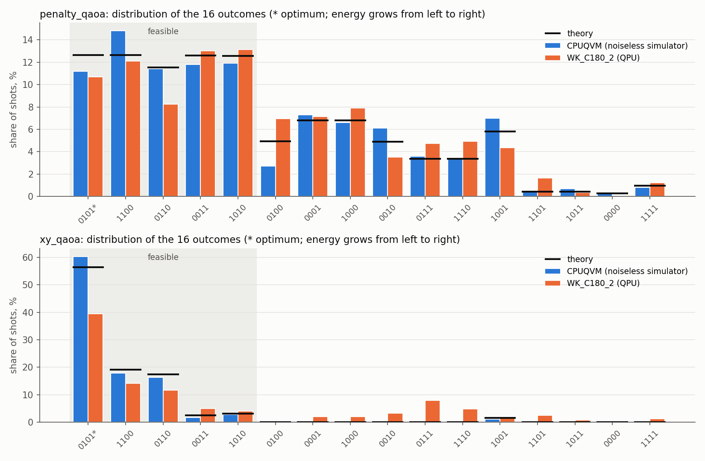
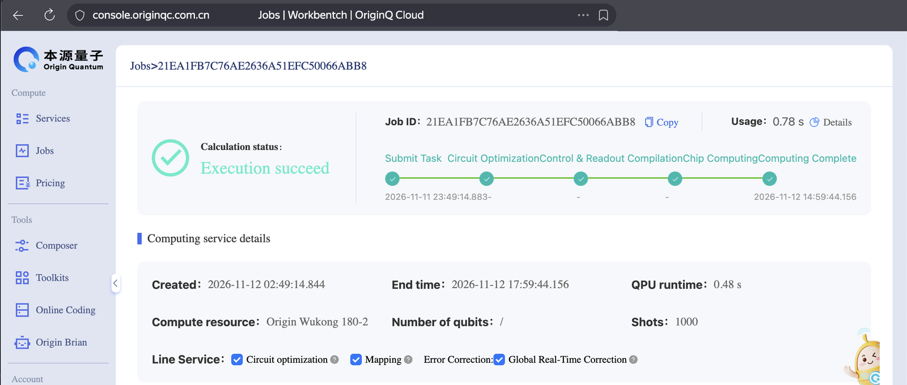
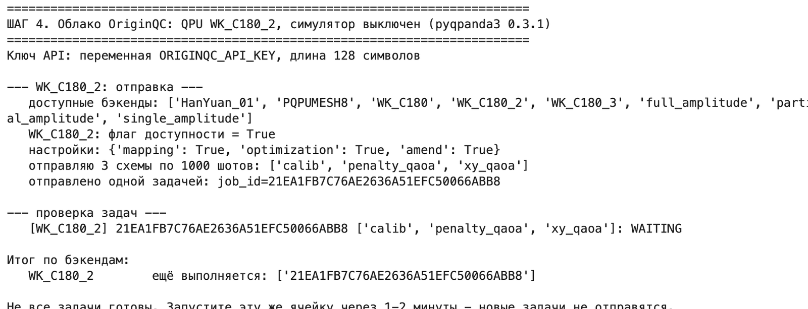
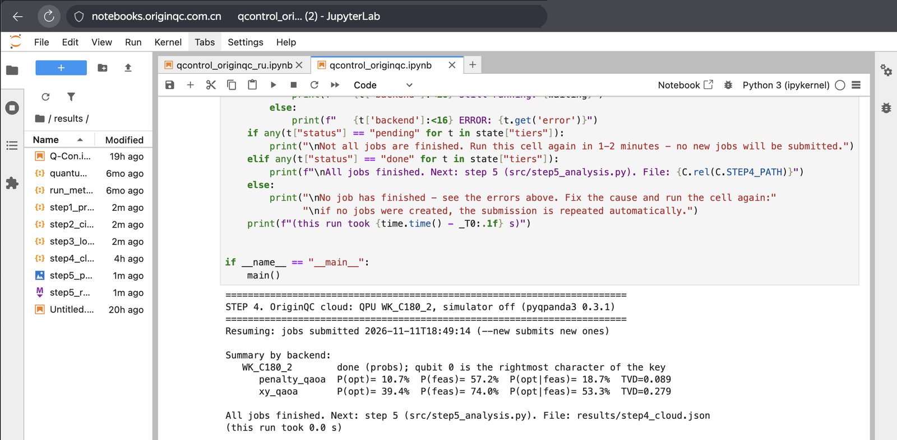
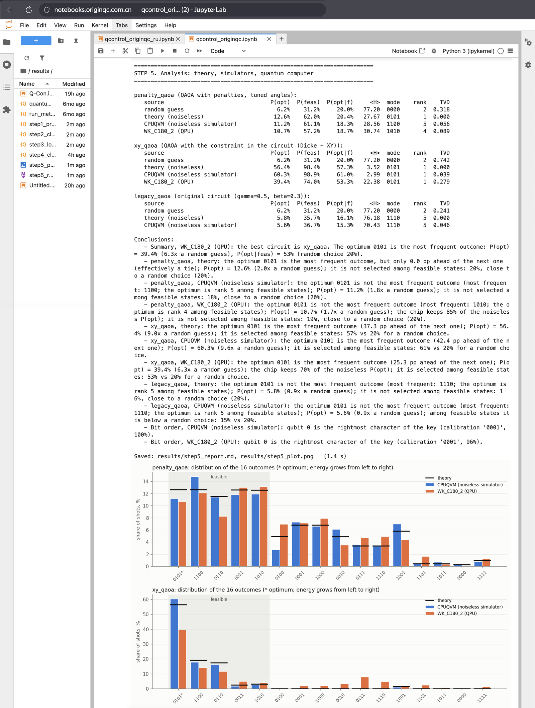
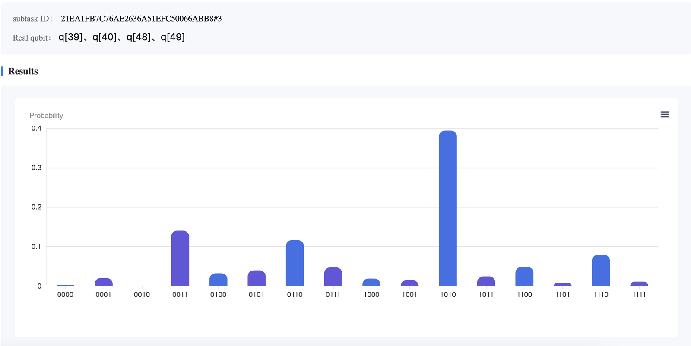
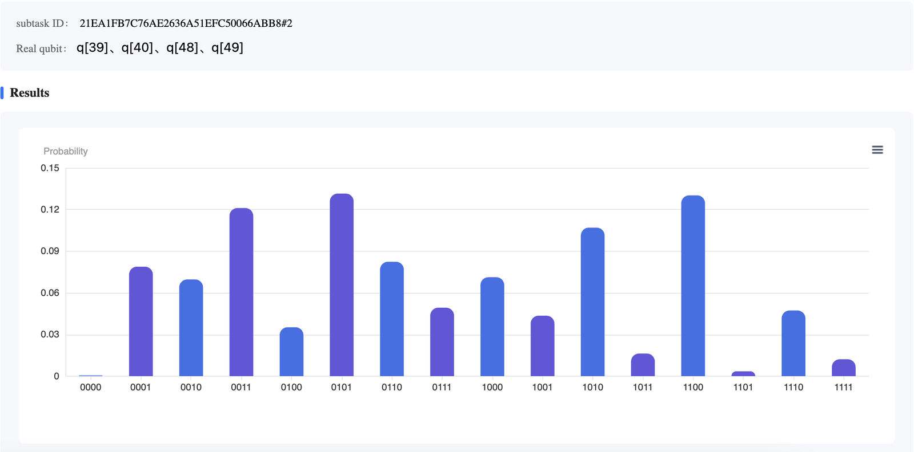
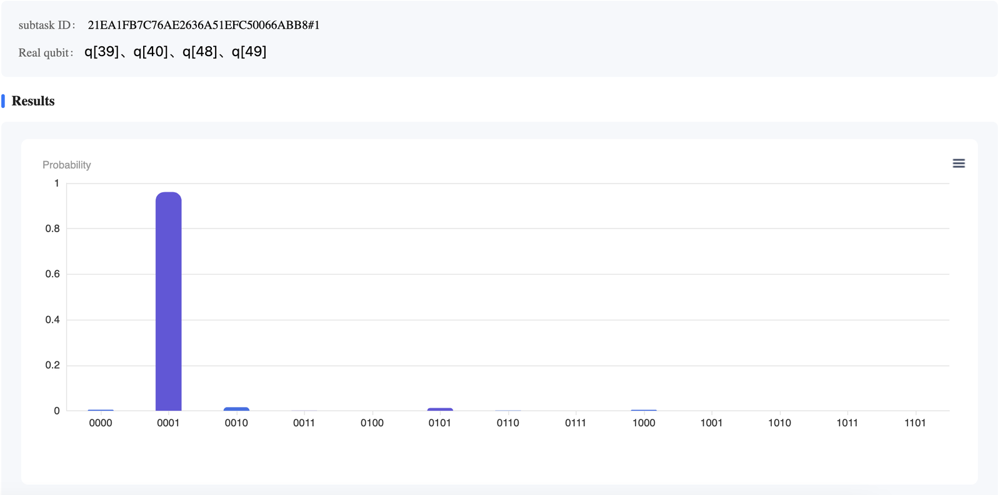

# Q-Control-Optimization: choosing backup lines of a substation on a quantum computer

**Русская версия: [README.ru.md](README.ru.md)**

**Author:** Svyatoslav Nikulin - 2nd-year B.Sc. student in Control Engineering (programme 27.03.04), Ural Federal
University, Yekaterinburg. Interested in feedback control systems: mathematical plant modelling, digital controller
design, and embedded implementation on microcontrollers.

The project grew out of a wish to understand how quantum computing and programming a quantum computer actually work:
which equations and principles turn a problem with a classical solution into a quantum algorithm, and what happens
when that algorithm runs on a real chip.

A teaching problem - emergency switching of backup power lines (automatic transfer switch, ATS) - is taken through
the whole chain: brute force → QUBO → Ising model → QAOA circuit → simulator → the superconducting quantum computer
**Origin Wukong 180-2** (OriginQC cloud, SDK `pyqpanda3`) → analysis.

**Result on the real chip.** The circuit with the constraint built into it (`xy_qaoa`) returned the optimal
configuration `0101` more often than any other answer: in **39.4%** of the shots versus 6.2% for a random guess
(56.4% without noise). Among feasible answers the optimum took **53%** (theory 57%, random choice 20%).
Machine time charged: **0.78 s**.



---

## 1. Problem

**Scenario.** A main substation has failed and 4 backup lines are available. Switching on each line costs a loss
`c = [1.2, 0.8, 1.5, 0.9]`. The transfer-switch controller must choose which lines to switch on. This is a typical
dispatch-control problem: find a feasible and optimal control action under hard constraints.

**Variables.** `x_i = 1` - line `i` is on, `0` - off. A configuration is written as the string `x0 x1 x2 x3`,
e.g. `0101` - lines 1 and 3 are on.

**Objective.** Minimal total loss `c0·x0 + c1·x1 + c2·x2 + c3·x3`.

**Hard constraints:**
1. Exactly 2 lines are on (`x0 + x1 + x2 + x3 = 2`): fewer means a power shortage, more overloads the bus.
2. Lines 0 and 3 must not be on together (`x0·x3 = 0`): they share a damaged section, which would cause a short circuit.

**All 16 configurations** (output of step 1, energy from the formula in section 2.1):

| x | H(x) | assessment |
|---|---|---|
| **0101** | **1.700** | **optimum: lines 1 and 3** |
| 1100 | 2.000 | feasible |
| 0110 | 2.300 | feasible |
| 0011 | 2.400 | feasible |
| 1010 | 2.700 | feasible |
| 0100, 0001, 1000, 0010 | 50.8-51.5 | 1 line on |
| 0111, 1110 | 53.2-53.5 | 3 lines on |
| 1001 | 102.1 | short circuit: lines 0 and 3 together |
| 1101, 1011 | 152.9-153.6 | 3 lines + short circuit |
| 0000 | 200.0 | no line on |
| 1111 | 304.4 | all 4 lines + short circuit |

**Hypothesis** (from the original problem statement): QAOA, even with a single layer (p = 1) on a noisy
quantum device, can single out the optimal control action. Brute force finds the optimum instantly, so speed is
not the goal. The goal is to show that the quantum circuit **itself** singles out the optimum and to verify this
on a real chip. When a quantum approach could pay off is discussed in section 4.

---

## 2. From the problem to a quantum circuit: the equations

### 2.1. QUBO: constraints become penalties

A quantum circuit cannot "forbid" configurations, so every constraint becomes a penalty term:

```
H(x) = Σ c_i·x_i  +  P1·(Σ x_i − 2)²  +  P2·x0·x3,      P1 = 50,  P2 = 100
```

For a feasible configuration the penalties vanish and H is just the loss. Expanding the brackets (with `x_i² = x_i`)
gives the quadratic form `H(x) = xᵀ·Q·x + const`, i.e. a QUBO problem. The matrix Q and the constant are saved in
`results/step1_problem.json`.

### 2.2. Ising model: variables become qubits

One line - one qubit. The substitution `x_i = (1 − Z_i)/2` (`Z_i = +1` for |0⟩, `−1` for |1⟩) gives an Ising
Hamiltonian:

```
H = const + Σ h_i·Z_i + Σ_{i<j} J_ij·Z_i·Z_j
h_i  = −Q_ii/2 − Σ_{j≠i} (Q_ij + Q_ji)/4
J_ij = (Q_ij + Q_ji)/4
```

The energy of each of the 16 configurations becomes an eigenvalue of this operator; finding the optimum means
finding the ground state of a physical system.

### 2.3. QAOA: equations become gates

```
|ψ(γ, β)⟩ = e^{−iβ·H_M} · e^{−iγ·H} · |ψ0⟩
```

| Step | Operator | Gates |
|---|---|---|
| Start | `\|ψ0⟩ = \|+⟩^⊗4`: all 16 configurations with equal amplitudes | `H` on every qubit |
| Cost layer | `e^{−iγ·h_i·Z_i}` | `RZ(2γ·h_i)` |
| | `e^{−iγ·J_ij·Z_i·Z_j}` | `CNOT(i,j) · RZ_j(2γ·J_ij) · CNOT(i,j)` |
| Mixer | `e^{−iβ·X_i}` | `RX(2β)` |
| Measurement | `P(x) = \|⟨x\|ψ⟩\|²` | `measure`, 1000 shots |

The cost layer gives every configuration a phase proportional to its energy; the mixer turns phase differences
into probability differences (interference). Two-qubit gates (CNOT) are needed so that the phase can depend on
a pair of variables (`x0·x3`, `(Σx)²`); they also create entanglement - without them the circuit is just
4 independent coins.

**The angles γ, β** are the tuning knobs. Step 2 tunes them on an exact simulator by minimising the mean energy
`⟨H⟩ = Σ P(x)·H(x)`; the chip receives an already tuned circuit. For the penalty circuit H is divided by
`max|H| = 304.4`, so that the angles stay in a convenient range.

### 2.4. XY-QAOA: the constraint "exactly 2 lines" is built into the circuit

This is a variant of the Quantum Alternating Operator Ansatz (Hadfield et al., 2019):
- **The start is the Dicke state D(4,2)** - an equal superposition of the 6 configurations with exactly 2 lines on:
  `(|0011⟩+|0101⟩+|0110⟩+|1001⟩+|1010⟩+|1100⟩)/√6`. The preparation circuit uses 8 CNOT; its fidelity is 1.0
  (verified in step 2).
- **The XY mixer** `e^{−iβ(X_a·X_b + Y_a·Y_b)/2}` on the ring 0-1-2-3-0 only moves the "on" state between
  neighbouring lines (|01⟩ ↔ |10⟩), so the number of lines switched on never changes. Constraint 1 is satisfied by
  the circuit itself, and the penalty of 50 is not needed.
- **The cost layer** keeps only the losses and a small penalty of 1.0 for the short circuit (the smallest one that
  makes `1001` more expensive than the worst feasible configuration: 3.1 > 2.7). The loss differences are no longer
  drowned by the penalties.

### 2.5. Circuits that are run

| Circuit | What it is | CNOT | Theory: P(optimum) | P(optimum among feasible) |
|---|---|---|---|---|
| `calib` | X on qubit 0 - determines the bit order of the answer (2.6) | 0 | - | - |
| `penalty_qaoa` | QAOA with penalties (sections 2.1-2.3), tuned angles | 12 | 12.6% | 20.4% |
| `xy_qaoa` | QAOA with the constraint in the circuit (section 2.4) | 18 | **56.4%** | **57.3%** |
| `legacy_qaoa` | the circuit of the first version as is: γ = 0.5, β = 0.3 (theory and simulator only) | 12 | 5.8% | 16.1% |
| random answer | for comparison | - | 6.2% | 20.0% |

**Why `penalty_qaoa` does not single out the optimum.** The penalties (50-304) are hundreds of times larger than
the loss differences between feasible configurations (0.3-1.0). When the angles are tuned by ⟨H⟩, the circuit learns
to avoid penalties - the share of feasible answers grows from 31% to 62% - but the five feasible configurations come
out almost equally often. In the working angle range (|γ| ≤ 2π for H/304.4) no angles raise the share of the optimum
among feasible answers above 25%. Caveat: with very large γ or a different tuning objective (CVaR) the penalty
circuit does single out the optimum in theory (CVaR₀.₃: P(optimum) ≈ 30%), but it does so by "wrapping" phases in
a small problem whose energies are all multiples of 0.1, and this does not carry over to large problems.

**Why the original circuit made things worse.** At γ = 0.5, β = 0.3 the penalties of 50 and 100 rotate the phase by
almost a whole number of turns (25 rad ≡ −0.13 rad mod 2π) and practically stop acting, while the sign of the angles
pushes the lines towards "on", the expensive ones more strongly. As a result the optimum ends up last among the
feasible configurations, P(optimum) = 5.8% - worse than a random guess.

### 2.6. Bit order

The backend returns an answer as a string such as `'0001'`, and **qubit 0 is the rightmost character**. This was
verified on CPUQVM and on Wukong 180-2: the `calib` circuit returned `'0001'` in 96% of the shots. Therefore the
configuration `0101` (lines 1 and 3) appears in the OriginQC console as the bar **`1010`**. The project's analysis
reverses the strings automatically based on the `calib` answer. The first version of the project read the strings
left to right, so its "22 shots of 0101" actually belonged to the configuration `1010`.

### 2.7. Metrics

| Metric | Meaning | Random answer |
|---|---|---|
| P(opt) | share of answers equal to the optimum `0101` | 6.2% |
| P(feas) | share of feasible answers | 31.2% |
| P(opt\|feas) | share of the optimum among feasible answers: can the circuit pick the best feasible configuration | 20% |
| ⟨H⟩ | mean energy of the answer (lower is better) | 77.2 |
| rank | place of the optimum among feasible configurations by frequency (1 = most frequent) | - |
| TVD | distance to theory: 0 - identical, 1 - nothing in common | - |

The ε metric of the first version ("the best feasible answer equals the optimum") was dropped: with 256 shots over
16 configurations the optimum is missed with probability ~10⁻⁷, so even a random number generator gets ε = 0.

---

## 3. Results on the quantum computer

### 3.1. The run

| Parameter | Value |
|---|---|
| Chip | Origin Wukong 180-2 (`WK_C180_2`), superconducting, 180 qubits |
| Physical qubits (chosen by the compiler) | q39, q40, q48, q49 |
| Circuits in the job | `calib`, `penalty_qaoa`, `xy_qaoa` - one batch job, 1000 shots each |
| Options | Circuit optimization, Mapping, Global Real-Time Correction (readout error correction) |
| Time on the chip / charged | **0.48 s / 0.78 s** |
| Waiting | about 15 hours: the chip went into maintenance and calibration right after submission |
| Submitted / finished | 11.11.2026 / 12.11.2026 |



**How to check that the computation ran on the chip.** The job id `21EA1FB7C76AE2636A51EFC50066ABB8` is the same
in three places:
- in the OriginQC console (screenshot above, address `console.originqc.com.cn`);
- in the notebook output at submission (screenshot below) and at result retrieval
  (log `notebook/qcontrol_originqc_ru.ipynb`);
- in `results/step4_cloud.json`.

The probabilities in that file match the bars in the console, e.g. key `1010` of `xy_qaoa` is 0.394.



After that the English notebook was run again in the same JupyterLab (`notebooks.originqc.com.cn`), next to this
`results/step4_cloud.json`. Step 4 took the finished job from the file and did not contact the cloud (0 s of quota);
the QPU numbers are the same. Steps 1-3 and 5 were recomputed, so the CPUQVM numbers below come from this rerun.
The notebook is stored with these outputs: `notebook/qcontrol_originqc.ipynb`.



### 3.2. Metrics

`xy_qaoa` - QAOA with the constraint in the circuit:

| Source | P(opt) | P(feas) | P(opt\|feas) | ⟨H⟩ | most frequent | optimum rank | TVD |
|---|---|---|---|---|---|---|---|
| random guess | 6.2% | 31.2% | 20.0% | 77.20 | - | - | 0.742 |
| theory (noiseless) | 56.4% | 98.4% | 57.3% | 3.52 | 0101 | 1 | 0 |
| CPUQVM (noiseless simulator) | 60.3% | 98.9% | 61.0% | 2.99 | 0101 | 1 | 0.039 |
| **Wukong 180-2** | **39.4%** | **74.0%** | **53.3%** | 22.38 | **0101** | **1** | 0.279 |

`penalty_qaoa` - QAOA with penalties (control circuit):

| Source | P(opt) | P(feas) | P(opt\|feas) | ⟨H⟩ | most frequent | optimum rank | TVD |
|---|---|---|---|---|---|---|---|
| theory (noiseless) | 12.6% | 62.0% | 20.4% | 27.67 | 0101 | 1 | 0 |
| CPUQVM (noiseless simulator) | 11.2% | 61.1% | 18.3% | 28.56 | 1100 | 5 | 0.056 |
| **Wukong 180-2** | **10.7%** | **57.2%** | **18.7%** | 30.74 | 1010 | 4 | 0.089 |

Full tables of all 16 configurations: `results/step5_report.md`. Raw answers of the chip: `results/step4_cloud.json`.

<details>
<summary>Full output of step 5 in the cloud notebook (screenshot stitched from 4 frames)</summary>



</details>

### 3.3. What the experiment shows

- **The optimum is the chip's most frequent answer**, 6.3 times more frequent than a random guess (about 43σ
  away from random at 1000 shots) - not a statistical accident.
- **Noise barely spoiled the choice among feasible configurations:** 53% vs 57% in theory. Most of the damage
  is answers with the wrong number of lines (about 25%), which a trivial classical check filters out.
- **Feasible configurations line up by loss.** On the chip `0101` 39.4%, `1100` 14.1%, `0110` 11.6%, `0011` 4.9%,
  `1010` 4.0% - exactly in the order of increasing loss (1.7 → 2.0 → 2.3 → 2.4 → 2.7).
- **The hardware reproduces theory; the difference between the circuits lies in the method.** The penalty circuit
  on the chip almost matched its theory (TVD 0.089) but did not single out the optimum there either.
- **Noise estimate.** If the chip's answer is modelled as "the ideal result with weight F + random noise", then
  F = 0.66 for a circuit with 18 CNOT, i.e. effectively about 0.977 per CNOT (including readout and decoherence).
  This estimate is used in section 4.

**How to read the console screenshots:** qubit 0 is the rightmost character of the key, so the optimum `0101` is
the bar `1010` here.

| `xy_qaoa`: the tall bar `1010` = configuration 0101 | `penalty_qaoa`: an almost flat distribution | Calibration `calib`: X on qubit 0 gives `'0001'` in 96% |
|---|---|---|
|  |  |  |

### 3.4. Criteria from the original problem statement

| Criterion | Outcome |
|---|---|
| The QUBO is mapped to the circuit correctly, the penalties work | yes: step-2 self-tests; the penalty circuit gives 57% feasible answers on the chip vs 31% for a random guess |
| The algorithm finds the global optimum (was: ε ≤ 10%) | ε replaced (it cannot tell the algorithm from a random guess); `xy_qaoa` on the chip: the optimum is the most frequent answer, 39.4% vs 6.2% |
| The constraints hold in a significant share of measurements | `xy_qaoa` on the chip: 74% feasible answers vs 31% for a random guess |
| The computation fits into the 60 s limit | each cell runs for seconds; 0.48 s on the chip, 0.78 s charged |
| **Hypothesis** | **confirmed for XY-QAOA** (p = 1, a real noisy chip); not confirmed for penalty QAOA with angles tuned by ⟨H⟩ |

---

## 4. Scaling: when a quantum algorithm could pay off

### 4.1. What grows with the number of lines n

| Lines n | Configurations 2ⁿ | Brute force at 10⁹ configurations/s | Qubits | CNOT in `xy_qaoa`, p = 1 (estimate) | Share of error-free runs at today's accuracy |
|---|---|---|---|---|---|
| 4 | 16 | instant | 4 | 18 (measured) | 0.66 (measured) |
| 10 | ~10³ | instant | 10 | ~110 | ~0.08 |
| 20 | ~10⁶ | ~1 ms | 20 | ~440 | ~4·10⁻⁵ |
| 50 | ~10¹⁵ | ~2 weeks | 50 | ~2 700 | ~0 |
| 100 | ~10³⁰ | ~4·10¹³ years | 100 | ~11 000 | 0 |

Where the estimates come from: Dicke-state preparation needs O(n·k) CNOT (Bärtschi & Eidenbenz, 2019), about n² for
k ≈ n/2; the mixer and the cost add 2n CNOT plus 2 per forbidden pair. The share of error-free runs is 0.977 raised to
the number of CNOT, where 0.977 is the value measured in section 3.3. All numbers are orders of magnitude.

### 4.2. What follows

1. **Brute force grows exponentially, the quantum circuit polynomially.** The number of qubits equals the number of
   lines, so Wukong 180 can physically hold a problem with about 180 lines. This is the main argument for the quantum
   approach.
2. **Today noise is the limit.** At 10 lines about 8% of the runs are error-free, at 20 practically none. For a
   50-line circuit to run error-free in at least half of the runs, the two-qubit gate error must be about 0.03% -
   roughly 100 times lower than today, i.e. the level of error-corrected logical qubits.
3. **The fair benchmark is not brute force.** Industrial integer-programming solvers (branch-and-bound and its
   descendants) solve dispatch problems with thousands of binary variables in seconds to minutes. For NP-hard
   problems quantum computers are not expected to give exponential speedups; QAOA is a heuristic without a proven
   advantage. Even a proven quadratic speedup (Grover-type) is too small to pay for the overhead of error correction
   (Babbush et al., 2021).

### 4.3. Where quantum algorithms make sense in practice

- **Not in a real-time control loop.** An ATS must act within milliseconds and deterministically. Here the
  computation on the chip took 0.48 s, but the queue took about 15 hours. For problems with 4-20 lines a controller
  with brute force or a table of precomputed decisions is faster and more reliable.
- **A possible niche is large offline planning:** network reconfiguration, generation scheduling, timetabling
  with hundreds to thousands of binary variables, where exact methods run out of time and heuristics get stuck. There
  a quantum algorithm is a candidate generator of good feasible solutions once error-corrected devices exist.
- **An advantage is possible only if all of the following hold at once:**
  1. the problem is large and hard for the best classical methods;
  2. errors are low enough for circuits of thousands to millions of gates to run reliably;
  3. the probability of finding a good solution does not decay exponentially with problem size (an open question);
  4. there is no hard real-time requirement.

### 4.4. What carries over from this project to large problems

- **Build constraints into the circuit instead of penalties.** The penalty `(Σx − k)²` couples all pairs of
  variables - n(n−1) CNOT per layer - and drowns the losses in the penalty scale; the XY mixer needs 2n CNOT per layer
  and keeps the loss differences. On the chip: 39.4% vs 10.7%.
- **Answers that break the rules are cheap to filter classically.** Among the chip's feasible answers the optimum
  takes 53%.
- **Verify the bit order and the calibration of every backend.** This is exactly where the first version of the
  project went wrong.
- **For large problems the angles are tuned by a hybrid loop.** Here the angles were tuned on an exact simulator,
  which needs 2ⁿ memory; for large problems it is replaced by a "QPU + classical optimiser" loop. According to the
  measurement, one circuit with 1000 shots is charged about 0.26 s, so a hundred iterations take tens of seconds of
  quota; the limit is the queue, not the computation time.

### 4.5. Bottom line

For the 4-line ATS problem a quantum computer is not needed - this is a demonstration of the method, and it succeeded:
on a real chip the optimal control action was chosen 6 times more often than at random. A quantum advantage in such
problems is possible only at hundreds of variables, in offline planning and on error-corrected devices - and even
there it is not proven yet. The value of the project is a verified chain "problem → QUBO → Ising → gates → chip →
analysis" and an engineering principle: constraints are built into the circuit rather than added as penalties.

---

## 5. How to run

### 5.1. Notebook in the OriginQC cloud (main way)

`notebook/qcontrol_originqc.ipynb` - the whole project in one file, an explanation before every code cell.
The notebook creates `data/config.json` itself; no other files need to be uploaded. It is stored with the outputs of
the English rerun (section 3.1); the original run with Russian output is kept in `notebook/qcontrol_originqc_ru.ipynb`.

1. In JupyterLab at `notebooks.originqc.com.cn` upload the notebook (Upload button).
2. Next to it create `key.txt` (File → New → Text File) and paste **only the key** from the OriginQC console:
   one line, no quotes, no `api_key =`.
3. Run the cells from top to bottom (Shift+Enter):

| Cell | What it does |
|---|---|
| API key | reads the key from `key.txt` into kernel memory; prints only its length |
| Settings | writes `data/config.json`: problem, shots, backend, circuits for the QPU |
| Shared functions | QUBO, gates, exact simulator, metrics (no output) |
| Step 1 | problem and optimum by brute force |
| Step 2 | circuits, angle tuning, theory (a few seconds) |
| Step 3 | CPUQVM simulator inside the notebook, optional |
| Step 4 | submission to the QPU and collection of the result |
| Step 5 | comparison, tables, plot |

4. **Step 4 works in two phases.** The first run submits one batch job, saves its id in `results/step4_cloud.json`
   and finishes immediately; after that, run the same cell again - it only checks the status and submits nothing new.
   The id survives a kernel restart. If the chip is under maintenance, the job waits in the queue (about 15 hours in
   our case; it could not be cancelled from the console). If `results/step4_cloud.json` with a finished job is
   already present, step 4 only shows its result and does not contact the cloud - so the notebook can be rerun
   completely without spending quota.
5. When step 4 prints "All jobs finished", run step 5. The `results/` folder can be downloaded.

**Backends** (answer of `service.backends()`): quantum computers `WK_C180`, `WK_C180_2`, `WK_C180_3`;
cloud simulators `full_amplitude`, `partial_amplitude`, `single_amplitude`. The backend is set in the Settings cell
(`qpu_backend`). Without rerunning steps 1-2 one can change `shots`, `qpu_backend`, `qpu_circuits`, `qpu_amend`,
`cloud_simulator`, `time_budget_sec`; changing the problem itself makes steps 3-4 ask for a rerun of steps 1-2.

**Quota.** QPU machine time is counted in seconds (page Jobs, column Usage). Our job (3 circuits × 1000 shots)
was charged 0.78 s. According to the OriginQC website, inviting a friend gives 30 s of Wukong time.

**Key safety.** The key lives only in `key.txt` (listed in `.gitignore`) or in the variable `ORIGINQC_API_KEY`;
neither the scripts nor the notebook print it. Do not call `QCloudService.setup_logging()` - it prints the
authorization header together with the key.

The line `QCloudResult.cpp ... get_counts_list result convert error` in the step-4 output is harmless: the code first
tries to read counts (the QPU does not provide them) and then takes probabilities.

### 5.2. Local check (no cloud, no key)

Needed only when changing the code - to check the steps before uploading to the cloud. Python 3.9+ and the packages
from `requirements.txt` (prebuilt wheels only):

```bash
python3 -m venv venv
venv/bin/python -m pip install --only-binary=:all: -r requirements.txt
venv/bin/python src/step1_problem.py      # problem and optimum
venv/bin/python src/step2_circuits.py     # circuits, angles, theory (~3 s)
venv/bin/python src/step3_local_run.py    # CPUQVM
venv/bin/python src/step5_analysis.py     # report and plot
python3 tools/build_notebook.py           # rebuild the notebook after changes in src/ or data/
```

A local run overwrites `results/`; the clean cloud run is restored with `git restore results/`. Rebuilding the
notebook removes its stored outputs (`git restore notebook/` brings them back). Recomputed angles may differ in
sign - these are equivalent solutions with the same probabilities.

On macOS 13, pyqpanda3 0.3.1 and 0.3.4 work; the PyPI wheels 0.3.5, 0.4.1 and 0.5.1 are built for macOS 26 and do not
import. The project uses 0.3.1, the same version as in the OriginQC notebook.

---

## 6. Project structure

```
README.md, README.ru.md              project description in English and Russian
data/config.json                     problem and run parameters (the Settings cell is built from it)
src/common.py                        shared functions: QUBO, gates, exact simulator, metrics, answer parsing
src/step1_problem.py ... step5_analysis.py   the five steps (the single source of the code)
tools/build_notebook.py              builds the notebook from src/ and data/
notebook/qcontrol_originqc.ipynb     notebook for the OriginQC cloud with the outputs of the rerun (built from src/)
notebook/qcontrol_originqc_ru.ipynb  original run with outputs, Russian version (record of the run on the chip)
results/                             cloud run: JSON of steps 1-4 (QPU answers in step4_cloud.json), step-5 report and plot
images/                              screenshots of the OriginQC console and the notebook
requirements.txt, LICENSE
```

The code lives in `src/`, and the notebook is built from it by a tool: the code is easy to read and to compare
between versions, and a single ready-made file is uploaded to the cloud.

---

## 7. Changes compared with the first version

The first version (Wukong 72, `origin_wukong`, May 2026) is kept in the git history of this repository.

| Before | Now |
|---|---|
| The answer was read left to right | Qubit 0 is the rightmost character; the order is checked by the `calib` circuit on every backend. The old "22 shots of 0101" belonged to configuration `1010` |
| γ = 0.5, β = 0.3 without justification | Angles are tuned on an exact simulator; with the old angles the circuit was worse than a random guess |
| Penalty QAOA as the main method | The main method is XY-QAOA; the penalty circuit is kept as a control |
| The metric ε = 0% as proof | ε proves nothing; metrics of section 2.7 with a comparison to a random guess |
| Chain QPU → cloud simulator → CPU with waiting inside a run | Levels run independently; the QPU is used through a two-phase submission |
| "Cloud simulator rejected by quota" | It was a code error: `QCloudJob` is not iterable, `job.result()` is needed |
| The final result came from a CPU simulator | The final result comes from the real Wukong 180-2 chip |
| Key in the code, `setup_logging()` enabled | Key in `key.txt` (in `.gitignore`) or an environment variable; SDK logging is not enabled |

## References

- E. Farhi, J. Goldstone, S. Gutmann. A Quantum Approximate Optimization Algorithm. arXiv:1411.4028 (2014).
- S. Hadfield et al. From the Quantum Approximate Optimization Algorithm to a Quantum Alternating Operator Ansatz.
  Algorithms 12, 34 (2019), arXiv:1709.03489.
- A. Lucas. Ising formulations of many NP problems. Frontiers in Physics 2, 5 (2014), arXiv:1302.5843.
- A. Bärtschi, S. Eidenbenz. Deterministic Preparation of Dicke States. arXiv:1904.07358 (2019).
- R. Babbush et al. Focus beyond quadratic speedups for error-corrected quantum advantage.
  PRX Quantum 2, 010103 (2021), arXiv:2011.04149.

## License

MIT - see [LICENSE](LICENSE).
