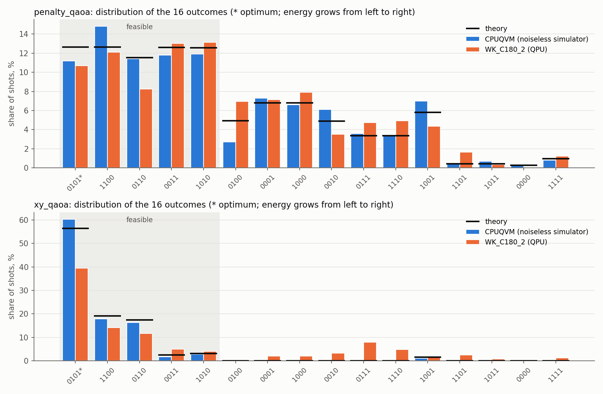
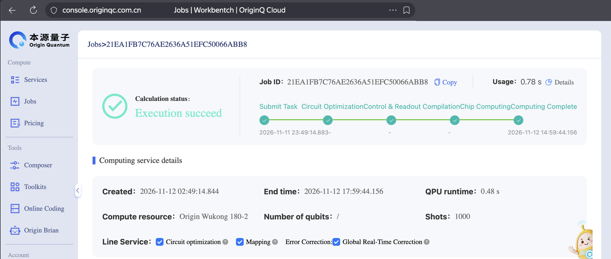
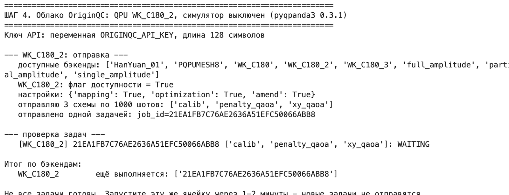
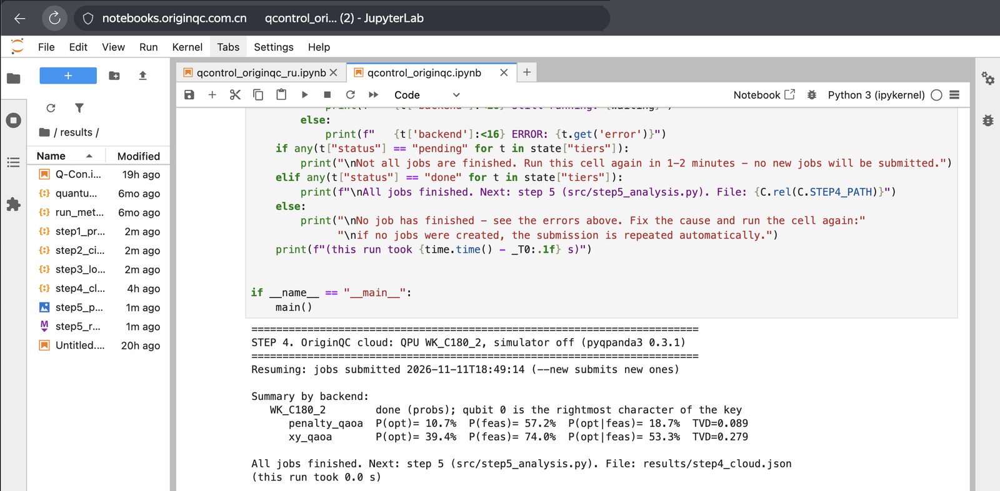
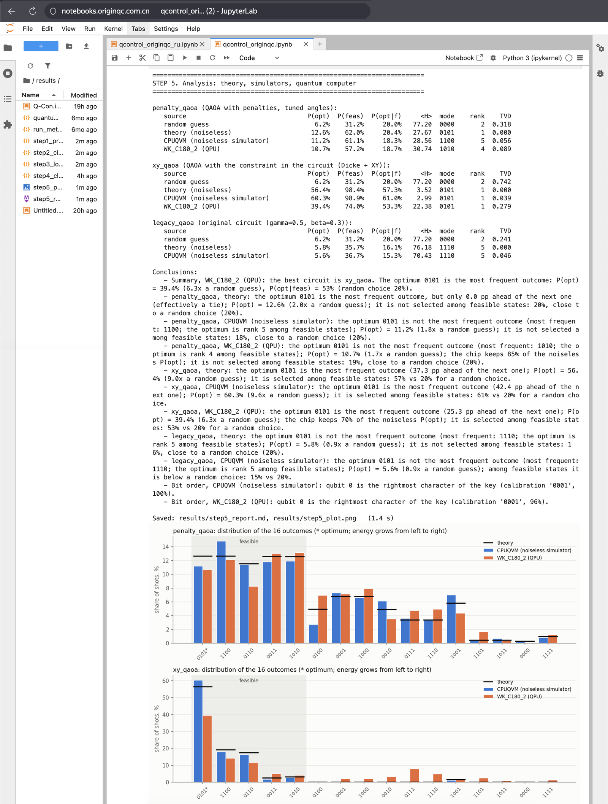
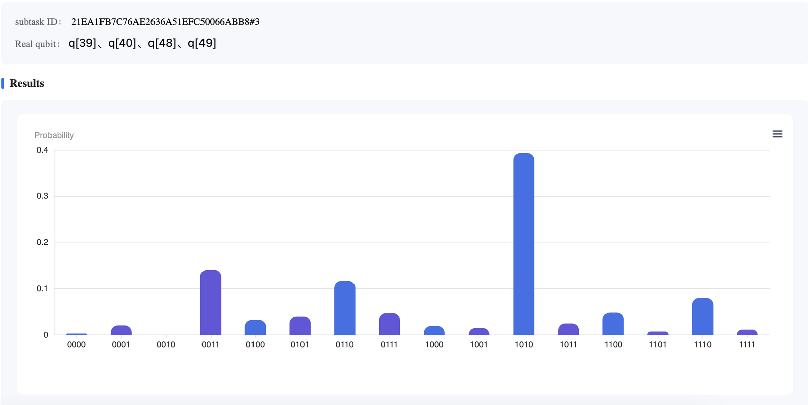
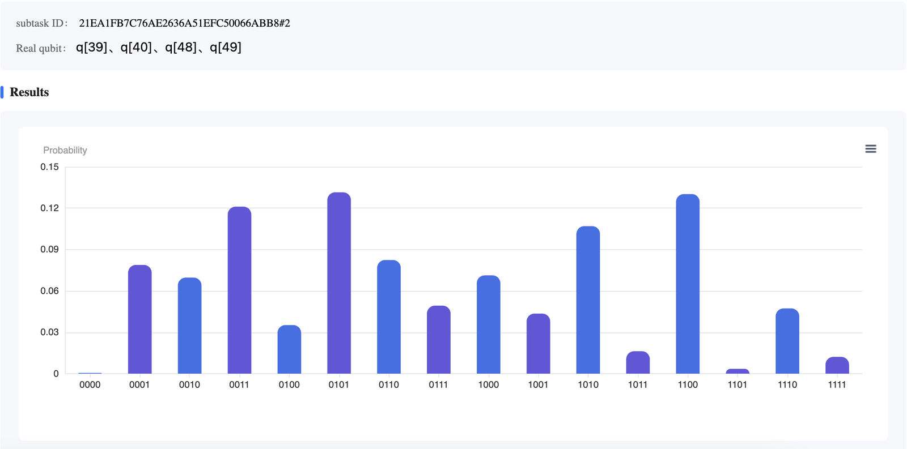
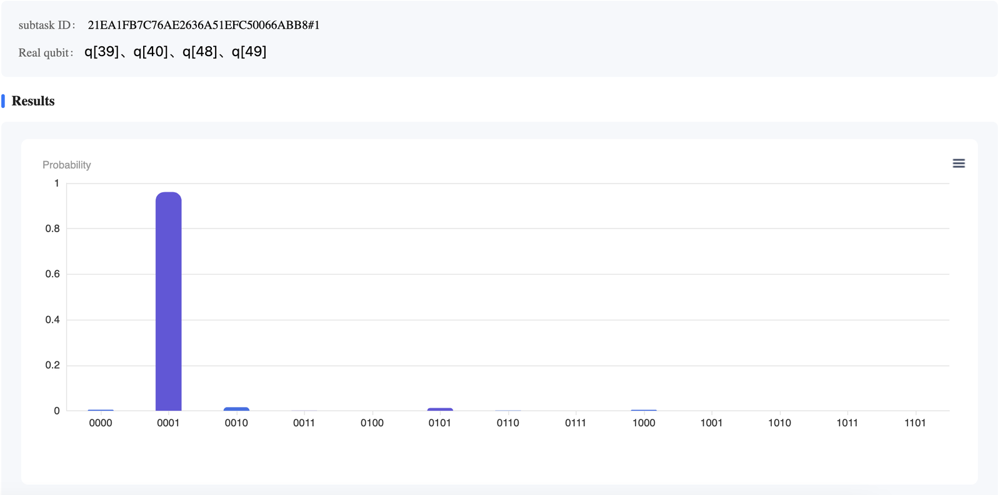
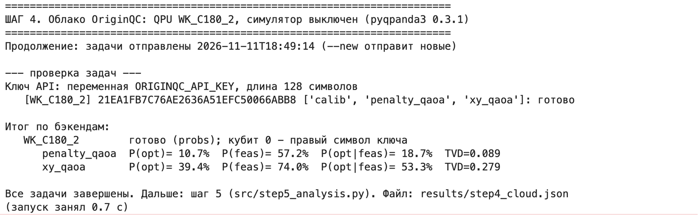

# Q-Control-Optimization: выбор резервных линий подстанции на квантовом компьютере

**English version: [README.md](README.md)**

**Автор:** Святослав Никулин - студент 2-го курса бакалавриата Уральского федерального университета (Екатеринбург),
направление 27.03.04 «Управление в технических системах». Интересы: системы управления с обратной связью -
математическое моделирование объектов, синтез цифровых регуляторов и их реализация на микроконтроллерах.

Проект вырос из желания понять, как устроены квантовые вычисления и программирование квантового
компьютера: какие уравнения и принципы переводят задачу из классического решения в квантовый алгоритм
и что из этого получается на реальном чипе.

Учебная задача: аварийное переключение резервных линий (АВР). Её решение проходит всю цепочку:
перебор → QUBO → модель Изинга → схема QAOA → симулятор → сверхпроводящий квантовый компьютер
**Origin Wukong 180-2** (облако OriginQC, SDK `pyqpanda3`) → анализ.

**Результат на реальном чипе.** Схема с ограничением, встроенным прямо в схему (`xy_qaoa`), выдала оптимальный
вариант `0101` чаще всех остальных: в **39.4%** запусков против 6.2% при случайном выборе. Без шума она даёт 56.4%.
Среди допустимых ответов оптимум занял **53%**, в теории 57%, при случайном выборе 20%. Машинное время: **0.78 с**.



---

## 1. Задача

**Сценарий.** На подстанции авария, есть 4 резервные линии. Потери при включении каждой из них:
`c = [1.2, 0.8, 1.5, 0.9]`. Автоматика ввода резерва должна выбрать, какие линии включить.
Это типичная задача диспетчерского управления: найти допустимое и наилучшее управляющее воздействие
при жёстких ограничениях.

**Переменные.** `x_i = 1` - линия `i` включена, `0` - выключена. Вариант записывается строкой `x0 x1 x2 x3`,
например `0101` - включены линии 1 и 3.

**Цель.** Минимальные суммарные потери `c0·x0 + c1·x1 + c2·x2 + c3·x3`.

**Жёсткие ограничения:**
1. Включено ровно 2 линии (`x0 + x1 + x2 + x3 = 2`): если меньше - не хватит мощности, если больше - перегрузка шины.
2. Линии 0 и 3 нельзя включать вместе (`x0·x3 = 0`): у них общий повреждённый участок, будет короткое замыкание (КЗ).

**Все 16 вариантов.** Расчёт шага 1, энергия по формуле из раздела 2.1:

| x | H(x) | оценка |
|---|---|---|
| **0101** | **1.700** | **оптимум: линии 1 и 3** |
| 1100 | 2.000 | допустимо |
| 0110 | 2.300 | допустимо |
| 0011 | 2.400 | допустимо |
| 1010 | 2.700 | допустимо |
| 0100, 0001, 1000, 0010 | 50.8-51.5 | включена 1 линия |
| 0111, 1110 | 53.2-53.5 | включены 3 линии |
| 1001 | 102.1 | КЗ: линии 0 и 3 вместе |
| 1101, 1011 | 152.9-153.6 | 3 линии + КЗ |
| 0000 | 200.0 | ни одной линии |
| 1111 | 304.4 | все 4 линии + КЗ |

**Гипотеза** (из исходной постановки). Алгоритм QAOA даже с одним слоем (p = 1) на шумном квантовом
устройстве способен выделить оптимальное управляющее воздействие. Классический перебор находит оптимум мгновенно,
поэтому цель проекта не в скорости. Цель - показать, что квантовая схема **сама** выделяет оптимум, и проверить это
на реальном чипе. О том, когда квантовый подход может стать выгодным, - раздел 4.

---

## 2. От задачи к квантовой схеме: формулы

### 2.1. QUBO: ограничения превращаются в штрафы

Квантовая схема не умеет «запрещать» варианты, поэтому каждое ограничение становится слагаемым-штрафом:

```
H(x) = Σ c_i·x_i  +  P1·(Σ x_i − 2)²  +  P2·x0·x3,      P1 = 50,  P2 = 100
```

У допустимого варианта штрафы равны нулю, и H - это просто потери. Раскрыв скобки (учитывая `x_i² = x_i`),
получаем квадратичную форму `H(x) = xᵀ·Q·x + const` - задачу QUBO. Матрица Q и константа сохраняются в
`results/step1_problem.json`.

### 2.2. Модель Изинга: переменные превращаются в кубиты

Каждая линия соответствует одному кубиту. Подстановка `x_i = (1 − Z_i)/2`, где `Z_i = +1` для |0⟩ и `−1` для |1⟩,
даёт гамильтониан Изинга:

```
H = const + Σ h_i·Z_i + Σ_{i<j} J_ij·Z_i·Z_j
h_i  = −Q_ii/2 − Σ_{j≠i} (Q_ij + Q_ji)/4
J_ij = (Q_ij + Q_ji)/4
```

Энергия каждого из 16 вариантов становится собственным значением этого оператора. Найти оптимум значит найти
основное состояние физической системы.

### 2.3. QAOA: формулы превращаются в гейты

```
|ψ(γ, β)⟩ = e^{−iβ·H_M} · e^{−iγ·H} · |ψ0⟩
```

| Шаг | Оператор | Гейты |
|---|---|---|
| Старт | `\|ψ0⟩ = \|+⟩^⊗4`: все 16 вариантов с равными амплитудами | `H` на каждом кубите |
| Слой стоимости | `e^{−iγ·h_i·Z_i}` | `RZ(2γ·h_i)` |
| | `e^{−iγ·J_ij·Z_i·Z_j}` | `CNOT(i,j) · RZ_j(2γ·J_ij) · CNOT(i,j)` |
| Смеситель | `e^{−iβ·X_i}` | `RX(2β)` |
| Измерение | `P(x) = \|⟨x\|ψ⟩\|²` | `measure`, 1000 шотов |

Слой стоимости даёт каждому варианту фазу, пропорциональную его энергии. Смеситель превращает разницу фаз
в разницу вероятностей (интерференция). Двухкубитные гейты (CNOT) нужны, чтобы фаза зависела от пары
переменных (`x0·x3`, `(Σx)²`). Они же создают запутанность: без них схема - это 4 независимые монетки.

**Углы γ, β** - это ручки настройки. Шаг 2 подбирает их на точном симуляторе по минимуму средней энергии
`⟨H⟩ = Σ P(x)·H(x)`, и на чип уходит уже настроенная схема. Для схемы со штрафами H делится на
`max|H| = 304.4`, чтобы углы лежали в удобном диапазоне.

### 2.4. XY-QAOA: ограничение «ровно 2 линии» встроено в схему

Это вариант Quantum Alternating Operator Ansatz (Hadfield et al., 2019):
- **Старт - состояние Дикке D(4,2).** Это равная суперпозиция 6 вариантов, где включены ровно 2 линии:
  `(|0011⟩+|0101⟩+|0110⟩+|1001⟩+|1010⟩+|1100⟩)/√6`. Схема подготовки содержит 8 CNOT, точность подготовки 1.0
  (проверено на шаге 2).
- **XY-смеситель** `e^{−iβ(X_a·X_b + Y_a·Y_b)/2}` по кольцу 0-1-2-3-0. Он только переносит «включённость»
  между соседними линиями (|01⟩ ↔ |10⟩), поэтому число включённых линий не меняется. Первое ограничение
  выполняется самой схемой, и штраф 50 не нужен.
- **В слое стоимости** остаются только потери и малый штраф 1.0 за КЗ. Это наименьший штраф, при котором `1001`
  дороже худшего допустимого варианта: 3.1 > 2.7. Разница потерь теперь не тонет в штрафах.

### 2.5. Какие схемы запускаются

| Схема | Что это | CNOT | Теория: P(оптимум) | P(оптимум среди допустимых) |
|---|---|---|---|---|
| `calib` | X на кубит 0 - определяет порядок битов в ответе (2.6) | 0 | - | - |
| `penalty_qaoa` | QAOA со штрафами (разделы 2.1-2.3), углы подобраны | 12 | 12.6% | 20.4% |
| `xy_qaoa` | QAOA с ограничением в схеме (раздел 2.4) | 18 | **56.4%** | **57.3%** |
| `legacy_qaoa` | схема первой версии как есть: γ = 0.5, β = 0.3 (только теория и симулятор) | 12 | 5.8% | 16.1% |
| случайный ответ | для сравнения | - | 6.2% | 20.0% |

**Почему `penalty_qaoa` не выделяет оптимум.** Штрафы (50-304) в сотни раз больше разницы потерь
между допустимыми вариантами (0.3-1.0). При подборе углов по ⟨H⟩ схема учится избегать штрафов:
доля допустимых ответов растёт с 31% до 62%. Но пять допустимых вариантов выходят почти поровну.
В рабочем диапазоне углов (|γ| ≤ 2π для H/304.4) никакие углы не поднимают долю оптимума среди допустимых
выше 25%. Оговорка: при очень больших γ или другой цели подбора (CVaR) схема со штрафами в теории выделяет оптимум
(CVaR₀.₃: P(оптимум) около 30%). Но это происходит за счёт «заворота» фаз на маленькой задаче, где все энергии
кратны 0.1, и на большие задачи такой приём не переносится.

**Почему старая схема ухудшала результат.** При γ = 0.5, β = 0.3 штрафы 50 и 100 «проворачиваются» по фазе почти
на целое число оборотов (25 рад ≡ −0.13 рад по модулю 2π) и почти перестают действовать. А знак углов толкает
линии во «включено», причём дорогие сильнее. В итоге оптимум оказывается на последнем месте среди допустимых,
P(оптимум) = 5.8% - хуже случайного выбора.

### 2.6. Порядок битов

Бэкенд возвращает ответ строкой вида `'0001'`, и **кубит 0 в ней - правый символ**. Это проверено на CPUQVM
и на Wukong 180-2: схема `calib` дала `'0001'` в 96% случаев. Поэтому в консоли OriginQC вариант `0101`
(линии 1 и 3) виден как столбик **`1010`**. Анализ проекта переворачивает строки автоматически по ответу `calib`.
Первая версия проекта читала строки слева направо, и её «22 шота у 0101» на самом деле относились к варианту `1010`.

### 2.7. Метрики

| Метрика | Смысл | Случайный ответ |
|---|---|---|
| P(opt) | доля ответов с оптимумом `0101` | 6.2% |
| P(feas) | доля допустимых ответов | 31.2% |
| P(opt\|feas) | доля оптимума среди допустимых: умеет ли схема выбрать лучший вариант | 20% |
| ⟨H⟩ | средняя энергия ответа (меньше - лучше) | 77.2 |
| ранг | место оптимума среди допустимых по частоте (1 - самый частый) | - |
| TVD | отличие от теории: 0 - совпадение, 1 - ничего общего | - |

Метрика ε из первой версии («лучший допустимый ответ совпал с оптимумом») убрана. За 256 шотов на 16 вариантах
оптимум не выпадет ни разу с вероятностью около 10⁻⁷, поэтому ε = 0 получает даже генератор случайных чисел.

---

## 3. Результаты на квантовом компьютере

### 3.1. Запуск

| Параметр | Значение |
|---|---|
| Чип | Origin Wukong 180-2 (`WK_C180_2`), сверхпроводящий, 180 кубитов |
| Физические кубиты (выбрал компилятор) | q39, q40, q48, q49 |
| Схемы в задаче | `calib`, `penalty_qaoa`, `xy_qaoa` - одной пакетной задачей, по 1000 шотов |
| Опции | Circuit optimization, Mapping, Global Real-Time Correction (поправка ошибок считывания) |
| Время на чипе / списано | **0.48 с / 0.78 с** |
| Ожидание | около 15 часов: на время отправки чип ушёл на обслуживание и калибровку |
| Отправка / завершение | 11.11.2026 / 12.11.2026 |



**Как проверить, что расчёт шёл на чипе.** Номер задачи `21EA1FB7C76AE2636A51EFC50066ABB8` один и тот же
в трёх местах:
- в консоли OriginQC (скриншот выше, адрес `console.originqc.com.cn`);
- в выводе ноутбука при отправке (скриншот ниже) и при получении результата
  (лог `notebook/qcontrol_originqc_ru.ipynb`);
- в файле `results/step4_cloud.json`.

Вероятности в этом файле совпадают со столбиками в консоли: например, ключ `1010` у `xy_qaoa` - 0.394.



После этого английский ноутбук запущен ещё раз в том же JupyterLab (`notebooks.originqc.com.cn`) рядом с этим
`results/step4_cloud.json`. Шаг 4 взял готовую задачу из файла и к облаку не обращался (0 с квоты), цифры QPU те же.
Шаги 1-3 и 5 пересчитаны, поэтому цифры CPUQVM ниже - из этого перезапуска. Ноутбук хранится с этими выводами:
`notebook/qcontrol_originqc.ipynb`.



### 3.2. Метрики

`xy_qaoa` - QAOA с ограничением в схеме:

| Источник | P(opt) | P(feas) | P(opt\|feas) | ⟨H⟩ | самый частый | ранг оптимума | TVD |
|---|---|---|---|---|---|---|---|
| случайный выбор | 6.2% | 31.2% | 20.0% | 77.20 | - | - | 0.742 |
| теория (без шума) | 56.4% | 98.4% | 57.3% | 3.52 | 0101 | 1 | 0 |
| CPUQVM (симулятор в ноутбуке) | 60.3% | 98.9% | 61.0% | 2.99 | 0101 | 1 | 0.039 |
| **Wukong 180-2** | **39.4%** | **74.0%** | **53.3%** | 22.38 | **0101** | **1** | 0.279 |

`penalty_qaoa` - QAOA со штрафами (контрольная схема):

| Источник | P(opt) | P(feas) | P(opt\|feas) | ⟨H⟩ | самый частый | ранг оптимума | TVD |
|---|---|---|---|---|---|---|---|
| теория (без шума) | 12.6% | 62.0% | 20.4% | 27.67 | 0101 | 1 | 0 |
| CPUQVM (симулятор в ноутбуке) | 11.2% | 61.1% | 18.3% | 28.56 | 1100 | 5 | 0.056 |
| **Wukong 180-2** | **10.7%** | **57.2%** | **18.7%** | 30.74 | 1010 | 4 | 0.089 |

Полные таблицы всех 16 вариантов: `results/step5_report.md`. Сырые ответы чипа: `results/step4_cloud.json`.

<details>
<summary>Полный вывод шага 5 в облачном ноутбуке (скриншот, склеен из 4 кадров)</summary>



</details>

### 3.3. Что показывает эксперимент

- **Оптимум - самый частый ответ чипа.** Он выпадает в 6.3 раза чаще, чем при случайном выборе; отклонение
  от случайного около 43σ при 1000 шотах, поэтому это не статистическая случайность.
- **Шум почти не испортил выбор среди допустимых вариантов:** 53% против 57% в теории. Основной урон от шума -
  ответы с неправильным числом линий (около 25%). Такие ответы отсекаются простой классической проверкой.
- **Допустимые варианты выстроились по потерям.** Частоты на чипе: `0101` 39.4%, `1100` 14.1%, `0110` 11.6%,
  `0011` 4.9%, `1010` 4.0% - ровно в порядке возрастания потерь (1.7 → 2.0 → 2.3 → 2.4 → 2.7).
- **Железо воспроизводит теорию, разница между схемами - в методе.** Схема со штрафами на чипе почти совпала
  с теорией (TVD 0.089), но оптимум не выделила ни там, ни там.
- **Оценка шума.** Если ответ чипа описать как смесь «идеальный результат с долей F + случайный шум», то
  F = 0.66 на схему из 18 CNOT. Это эффективно около 0.977 на один CNOT, включая считывание и декогеренцию.
  Эта оценка используется в разделе 4.

**Как читать скриншоты консоли:** кубит 0 - правый символ ключа, поэтому оптимум `0101` здесь - столбик `1010`.

| `xy_qaoa`: высокий столбик `1010` = вариант 0101 | `penalty_qaoa`: распределение почти ровное |
|---|---|
|  |  |

| Калибровка `calib`: X на кубит 0 даёт `'0001'` в 96% | Шаг 4 в ноутбуке исходного прогона: результат забран |
|---|---|
|  |  |

Лог исходного прогона (получение результата с чипа и анализ) - в `notebook/qcontrol_originqc_ru.ipynb`.

### 3.4. Критерии из исходной постановки

| Критерий | Итог |
|---|---|
| QUBO верно переведена в схему, штрафы работают | да: самопроверки шага 2; схема со штрафами на чипе даёт 57% допустимых ответов против 31% у случайного выбора |
| Алгоритм находит глобальный оптимум (было ε ≤ 10%) | ε заменена: она не отличает алгоритм от случайного выбора. `xy_qaoa` на чипе: оптимум - самый частый ответ, 39.4% против 6.2% |
| Ограничения выполняются в значимой доле измерений | `xy_qaoa` на чипе: 74% допустимых ответов против 31% у случайного выбора |
| Расчёт укладывается в лимит 60 с | каждая ячейка работает секунды; на чипе 0.48 с, списано 0.78 с |
| **Гипотеза** | **подтверждена для XY-QAOA** (p = 1, реальный шумный чип). Для QAOA со штрафами и подбором углов по ⟨H⟩ не подтверждена |

---

## 4. Масштабирование: когда квантовый алгоритм может дать преимущество

### 4.1. Что растёт с числом линий n

| Линий n | Вариантов 2ⁿ | Перебор при 10⁹ вариантов/с | Кубитов | CNOT в `xy_qaoa`, p = 1 (оценка) | Доля запусков без ошибки при нынешней точности |
|---|---|---|---|---|---|
| 4 | 16 | мгновенно | 4 | 18 (факт) | 0.66 (факт) |
| 10 | ~10³ | мгновенно | 10 | ~110 | ~0.08 |
| 20 | ~10⁶ | ~1 мс | 20 | ~440 | ~4·10⁻⁵ |
| 50 | ~10¹⁵ | ~2 недели | 50 | ~2 700 | ~0 |
| 100 | ~10³⁰ | ~4·10¹³ лет | 100 | ~11 000 | 0 |

Откуда оценки. Подготовка состояния Дикке требует O(n·k) CNOT (Bärtschi & Eidenbenz, 2019); при k ≈ n/2 это около n².
Смеситель и стоимость добавляют ещё 2n CNOT плюс по 2 на каждый запрет. Доля запусков без ошибки - это 0.977 в
степени числа CNOT, где 0.977 - значение, измеренное в разделе 3.3. Все цифры - порядки величины.

### 4.2. Что из этого следует

1. **Перебор растёт экспоненциально, квантовая схема - полиномиально.** Кубитов нужно столько же, сколько линий,
   и Wukong 180 физически вмещает задачу примерно на 180 линий. Это и есть основной довод в пользу квантового
   подхода.
2. **Сегодня всё упирается в шум.** На 10 линиях без ошибки проходит около 8% запусков, на 20 - практически ни одного.
   Чтобы схема на 50 линий проходила без ошибки хотя бы в половине запусков, ошибка двухкубитного гейта должна быть
   около 0.03%. Это примерно в 100 раз меньше, чем сейчас, - уровень логических кубитов с коррекцией ошибок.
3. **Честная планка сравнения - не перебор.** Промышленные решатели целочисленного программирования
   (метод ветвей и границ и его развития) решают задачи распределения с тысячами двоичных переменных за секунды
   или минуты. Для NP-трудных задач квантовый компьютер, по современным представлениям, не даёт экспоненциального
   ускорения. QAOA - эвристика, и выигрыш от неё не доказан. Даже доказанного квадратичного ускорения
   (как у алгоритма Гровера) мало, чтобы окупить накладные расходы коррекции ошибок (Babbush et al., 2021).

### 4.3. Где квантовые алгоритмы имеют смысл в реальных условиях

- **Не в контуре реального времени.** АВР должен срабатывать за миллисекунды, причём гарантированно. В этом
  эксперименте расчёт на чипе занял 0.48 с, а ожидание в очереди - около 15 часов. Для задач на 4-20 линий
  контроллер с перебором или таблицей заранее рассчитанных решений быстрее и надёжнее.
- **Возможная ниша - офлайн-планирование большого размера:** реконфигурация сетей, распределение генерации,
  расписания с сотнями и тысячами двоичных переменных, где точные методы не укладываются во время, а эвристики
  застревают. Там квантовый алгоритм - кандидат на генератор хороших допустимых решений, когда появятся
  устройства с коррекцией ошибок.
- **Преимущество возможно, только если одновременно выполнены все условия:**
  1. задача большая и трудная для лучших классических методов;
  2. ошибки настолько малы, что схемы из тысяч и миллионов гейтов проходят надёжно;
  3. вероятность найти хорошее решение не падает экспоненциально с ростом задачи - это пока открытый вопрос;
  4. нет требования жёсткого реального времени.

### 4.4. Что из этого проекта переносится на большие задачи

- **Ограничения лучше встраивать в схему, а не в штрафы.** Штраф `(Σx − k)²` связывает все пары переменных:
  n(n−1) CNOT на слой, и потери тонут в масштабе штрафов. XY-смеситель требует 2n CNOT на слой и сохраняет
  разницу потерь. На чипе это дало 39.4% против 10.7%.
- **Ответы, нарушающие правила, дёшево отсекаются классической проверкой.** Среди допустимых ответов чипа
  оптимум занимает 53%.
- **Порядок битов и калибровку каждого бэкенда нужно проверять отдельно.** Первая версия проекта ошиблась
  именно здесь.
- **Углы для больших задач подбирает гибридный цикл.** Здесь углы подбирались на точном симуляторе, а ему нужно
  2ⁿ памяти; на больших задачах вместо него работает цикл «QPU + классический оптимизатор». По замеру одна схема
  на 1000 шотов списывает около 0.26 с, так что сотня итераций - это десятки секунд квоты. Ограничивает
  не время счёта, а ожидание в очереди.

### 4.5. Итог

Для задачи АВР на 4 линиях квантовый компьютер не нужен. Это демонстрация метода, и она удалась: на реальном
чипе оптимальное управляющее воздействие выбрано в 6 раз чаще случайного. Выигрыш квантовых алгоритмов в
таких задачах возможен только на сотнях переменных, в офлайн-планировании и на устройствах с коррекцией ошибок,
и даже там он пока не доказан. Ценность проекта - в проверенной цепочке «задача → QUBO → Изинг → гейты → чип →
анализ» и в инженерном принципе: ограничения встраиваются в схему, а не навешиваются штрафами.

---

## 5. Как запустить

### 5.1. Ноутбук в облаке OriginQC (основной способ)

`notebook/qcontrol_originqc.ipynb` - весь проект в одном файле: перед каждой ячейкой с кодом идёт пояснение.
Ноутбук сам создаёт `data/config.json`, загружать остальные файлы не нужно. Пояснения и вывод программы - на
английском; ноутбук хранится с выводами английского перезапуска (раздел 3.1). Исходный прогон с русским выводом
сохранён в `notebook/qcontrol_originqc_ru.ipynb`.

1. В JupyterLab на `notebooks.originqc.com.cn` загрузить ноутбук (кнопка Upload).
2. Рядом с ним создать файл `key.txt` (File → New → Text File) и вставить туда **только ключ** из консоли OriginQC:
   одной строкой, без кавычек и без `api_key =`.
3. Выполнять ячейки сверху вниз (Shift+Enter):

| Ячейка | Что делает |
|---|---|
| API key | читает ключ из `key.txt` в память ядра; сам ключ не печатается, только его длина |
| Settings | записывает `data/config.json`: задача, шоты, бэкенд, схемы для QPU |
| Shared functions | QUBO, гейты, точный симулятор, метрики (вывода нет) |
| Step 1 | задача и оптимум перебором |
| Step 2 | схемы, подбор углов, теория (несколько секунд) |
| Step 3 | симулятор CPUQVM внутри ноутбука, по желанию |
| Step 4 | отправка на QPU и сбор результата |
| Step 5 | сравнение, таблицы, график |

4. **Шаг 4 выполняется в два захода.** Первый раз он отправляет одну пакетную задачу, сохраняет номер задачи в
   `results/step4_cloud.json` и сразу заканчивается. Дальше ту же ячейку нужно запускать повторно: она только
   проверяет статус и новых задач не отправляет. Номер не потеряется и после перезапуска ядра. Если чип на
   обслуживании, задача ждёт в очереди: в нашем случае около 15 часов, отменить её из консоли не удалось.
   Если в папке уже лежит `results/step4_cloud.json` с готовой задачей, шаг 4 только показывает её результат
   и к облаку не обращается: так ноутбук можно перезапустить целиком, не тратя квоту.
5. Когда шаг 4 напишет «All jobs finished», выполнить шаг 5. Папку `results/` можно скачать.

**Бэкенды** (ответ `service.backends()`): квантовые компьютеры `WK_C180`, `WK_C180_2`, `WK_C180_3`;
облачные симуляторы `full_amplitude`, `partial_amplitude`, `single_amplitude`. Бэкенд меняется в ячейке
«Settings» (`qpu_backend`). Без перезапуска шагов 1-2 можно менять `shots`, `qpu_backend`, `qpu_circuits`,
`qpu_amend`, `cloud_simulator`, `time_budget_sec`. Если изменить саму задачу, шаги 3-4 попросят перезапустить шаги 1-2.

**Квота.** Машинное время QPU считается в секундах (страница Jobs, колонка Usage). Наша задача
(3 схемы × 1000 шотов) списала 0.78 с. По данным сайта OriginQC, за приглашение друга начисляется 30 с Wukong.

**Безопасность ключа.** Ключ хранится только в `key.txt` или в переменной `ORIGINQC_API_KEY`. Файл `key.txt`
внесён в `.gitignore`. Ни скрипты, ни ноутбук ключ не печатают. Вызывать `QCloudService.setup_logging()` нельзя:
он выводит заголовок авторизации вместе с ключом.

Строка `QCloudResult.cpp ... get_counts_list result convert error` в выводе шага 4 безвредна. Код сначала
пробует взять счётчики, а у QPU их нет, и тогда берёт вероятности.

### 5.2. Локальная проверка (без облака и без ключа)

Нужна только при правках кода: проверить шаги до загрузки в облако. Требуются Python 3.9+ и пакеты из
`requirements.txt`, только готовыми сборками:

```bash
python3 -m venv venv
venv/bin/python -m pip install --only-binary=:all: -r requirements.txt
venv/bin/python src/step1_problem.py      # задача и оптимум
venv/bin/python src/step2_circuits.py     # схемы, углы, теория (~3 с)
venv/bin/python src/step3_local_run.py    # CPUQVM
venv/bin/python src/step5_analysis.py     # отчёт и график
python3 tools/build_notebook.py           # пересобрать ноутбук после правок в src/ или data/
```

Локальный запуск перезаписывает `results/`. Вернуть чистовой прогон из облака можно командой `git restore results/`.
Пересборка ноутбука стирает сохранённые в нём выводы (вернуть: `git restore notebook/`).
Углы при пересчёте могут получиться с другим знаком: это эквивалентные решения с теми же вероятностями.

На macOS 13 работают pyqpanda3 0.3.1 и 0.3.4. Сборки 0.3.5, 0.4.1 и 0.5.1 с PyPI собраны под macOS 26 и не импортируются.
В проекте выбрана 0.3.1 - та же версия, что в ноутбуке OriginQC.

---

## 6. Структура проекта

```
README.md, README.ru.md              описание проекта на английском и на русском
data/config.json                     параметры задачи и запуска (из них собирается ячейка «Settings»)
src/common.py                        общие функции: QUBO, гейты, точный симулятор, метрики, разбор ответов
src/step1_problem.py ... step5_analysis.py   пять шагов (единственный источник кода)
tools/build_notebook.py              собирает ноутбук из src/ и data/
notebook/qcontrol_originqc.ipynb     ноутбук для облака OriginQC с выводами перезапуска (собирается из src/)
notebook/qcontrol_originqc_ru.ipynb  исходный прогон с выводами, русская версия (запись запуска на чипе)
results/                             прогон в облаке: JSON шагов 1-4 (ответы QPU в step4_cloud.json), отчёт и график шага 5
images/                              скриншоты консоли OriginQC и ноутбука
requirements.txt, LICENSE
```

Код хранится в `src/`, а ноутбук собирается из него инструментом. Так код удобно читать и сравнивать по версиям,
а в облако загружается один готовый файл.

---

## 7. Что изменилось по сравнению с первой версией

Первая версия (Wukong 72, `origin_wukong`, май 2026) сохранена в истории git этого репозитория.

| Было | Стало |
|---|---|
| Ответ читался слева направо | Кубит 0 - правый символ; порядок проверяется схемой `calib` на каждом бэкенде. Старые «22 шота у 0101» относились к варианту `1010` |
| γ = 0.5, β = 0.3 без обоснования | Углы подбираются на точном симуляторе; со старыми углами схема работала хуже случайного выбора |
| QAOA со штрафами как основной метод | Основной метод - XY-QAOA; штрафная схема оставлена для контроля |
| Метрика ε = 0% как доказательство | ε ничего не доказывает; метрики из раздела 2.7 со сравнением со случайным выбором |
| Цепочка QPU → облачный симулятор → CPU с ожиданием внутри запуска | Уровни запускаются независимо; QPU - отправкой в два захода |
| «Облачный симулятор отклонён по квотам» | Это была ошибка кода: `QCloudJob` не итерируется, нужен `job.result()` |
| Итог получен на CPU-симуляторе | Итог получен на реальном чипе Wukong 180-2 |
| Ключ в коде, включён `setup_logging()` | Ключ в `key.txt` (в `.gitignore`) или в переменной окружения; логирование SDK не включается |

## Литература

- E. Farhi, J. Goldstone, S. Gutmann. A Quantum Approximate Optimization Algorithm. arXiv:1411.4028 (2014).
- S. Hadfield et al. From the Quantum Approximate Optimization Algorithm to a Quantum Alternating Operator Ansatz.
  Algorithms 12, 34 (2019), arXiv:1709.03489.
- A. Lucas. Ising formulations of many NP problems. Frontiers in Physics 2, 5 (2014), arXiv:1302.5843.
- A. Bärtschi, S. Eidenbenz. Deterministic Preparation of Dicke States. arXiv:1904.07358 (2019).
- R. Babbush et al. Focus beyond quadratic speedups for error-corrected quantum advantage.
  PRX Quantum 2, 010103 (2021), arXiv:2011.04149.

## Лицензия

MIT - см. файл [LICENSE](LICENSE).
