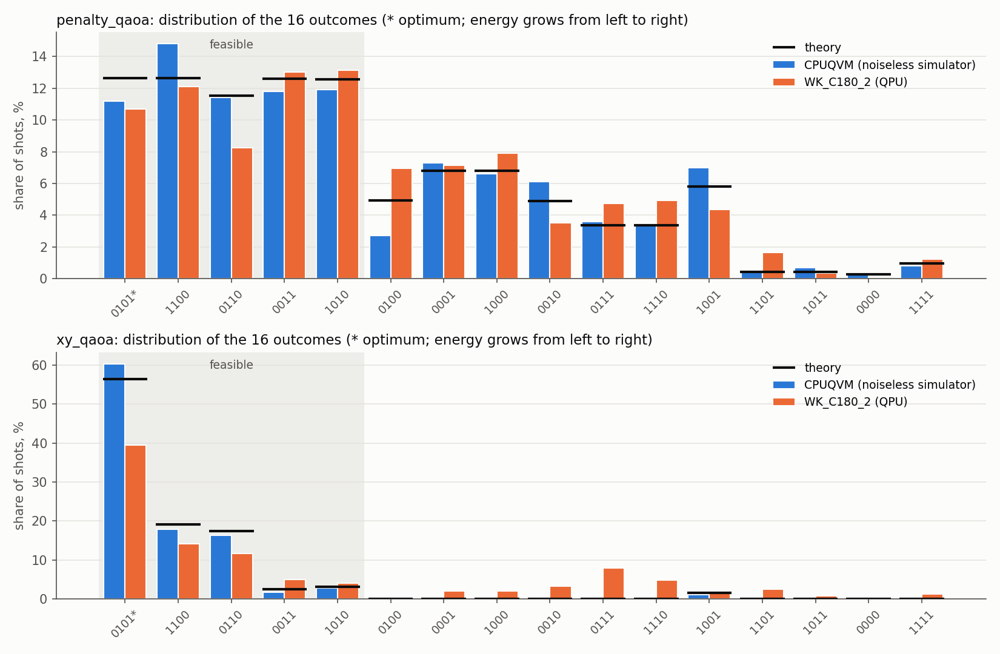

# Step 5. Results analysis

Created: 2026-11-12T14:19:45. Optimum of the problem: ['0101'] (H = 1.700). Sources: theory, CPUQVM (noiseless simulator), WK_C180_2 (QPU).

## penalty_qaoa - QAOA with penalties, tuned angles

| source | P(opt) | P(feas) | P(opt\|feas) | ⟨H⟩ | most frequent | optimum rank | TVD |
|---|---|---|---|---|---|---|---|
| random guess | 6.2% | 31.2% | 20.0% | 77.20 | 0000 | 2 | 0.318 |
| theory (noiseless) | 12.6% | 62.0% | 20.4% | 27.67 | 0101 | 1 | 0.000 |
| CPUQVM (noiseless simulator) | 11.2% | 61.1% | 18.3% | 28.56 | 1100 | 5 | 0.056 |
| WK_C180_2 (QPU) | 10.7% | 57.2% | 18.7% | 30.74 | 1010 | 4 | 0.089 |

## xy_qaoa - QAOA with the constraint in the circuit (Dicke + XY)

| source | P(opt) | P(feas) | P(opt\|feas) | ⟨H⟩ | most frequent | optimum rank | TVD |
|---|---|---|---|---|---|---|---|
| random guess | 6.2% | 31.2% | 20.0% | 77.20 | 0000 | 2 | 0.742 |
| theory (noiseless) | 56.4% | 98.4% | 57.3% | 3.52 | 0101 | 1 | 0.000 |
| CPUQVM (noiseless simulator) | 60.3% | 98.9% | 61.0% | 2.99 | 0101 | 1 | 0.039 |
| WK_C180_2 (QPU) | 39.4% | 74.0% | 53.3% | 22.38 | 0101 | 1 | 0.279 |

## legacy_qaoa - original circuit (gamma=0.5, beta=0.3)

| source | P(opt) | P(feas) | P(opt\|feas) | ⟨H⟩ | most frequent | optimum rank | TVD |
|---|---|---|---|---|---|---|---|
| random guess | 6.2% | 31.2% | 20.0% | 77.20 | 0000 | 2 | 0.241 |
| theory (noiseless) | 5.8% | 35.7% | 16.1% | 76.18 | 1110 | 5 | 0.000 |
| CPUQVM (noiseless simulator) | 5.6% | 36.7% | 15.3% | 70.43 | 1110 | 5 | 0.046 |

### penalty_qaoa: probabilities of all 16 outcomes, %

| x | H | feasible | theory | CPUQVM (noiseless simulator) | WK_C180_2 (QPU) |
|---|---|---|---|---|---|
| 0101 * | 1.7 | yes | 12.6 | 11.2 | 10.7 |
| 1100 | 2.0 | yes | 12.6 | 14.8 | 12.1 |
| 0110 | 2.3 | yes | 11.5 | 11.4 | 8.2 |
| 0011 | 2.4 | yes | 12.6 | 11.8 | 13.0 |
| 1010 | 2.7 | yes | 12.6 | 11.9 | 13.2 |
| 0100 | 50.8 | - | 4.9 | 2.7 | 7.0 |
| 0001 | 50.9 | - | 6.8 | 7.3 | 7.1 |
| 1000 | 51.2 | - | 6.8 | 6.6 | 7.9 |
| 0010 | 51.5 | - | 4.9 | 6.1 | 3.5 |
| 0111 | 53.2 | - | 3.4 | 3.6 | 4.7 |
| 1110 | 53.5 | - | 3.4 | 3.4 | 4.9 |
| 1001 | 102.1 | - | 5.8 | 7.0 | 4.4 |
| 1101 | 152.9 | - | 0.4 | 0.4 | 1.6 |
| 1011 | 153.6 | - | 0.4 | 0.7 | 0.4 |
| 0000 | 200.0 | - | 0.3 | 0.3 | 0.0 |
| 1111 | 304.4 | - | 1.0 | 0.8 | 1.2 |

### xy_qaoa: probabilities of all 16 outcomes, %

| x | H | feasible | theory | CPUQVM (noiseless simulator) | WK_C180_2 (QPU) |
|---|---|---|---|---|---|
| 0101 * | 1.7 | yes | 56.4 | 60.3 | 39.4 |
| 1100 | 2.0 | yes | 19.1 | 17.9 | 14.1 |
| 0110 | 2.3 | yes | 17.3 | 16.3 | 11.6 |
| 0011 | 2.4 | yes | 2.4 | 1.7 | 4.9 |
| 1010 | 2.7 | yes | 3.1 | 2.7 | 4.0 |
| 0100 | 50.8 | - | 0.0 | 0.0 | 0.0 |
| 0001 | 50.9 | - | 0.0 | 0.0 | 1.9 |
| 1000 | 51.2 | - | 0.0 | 0.0 | 2.1 |
| 0010 | 51.5 | - | 0.0 | 0.0 | 3.2 |
| 0111 | 53.2 | - | 0.0 | 0.0 | 7.9 |
| 1110 | 53.5 | - | 0.0 | 0.0 | 4.7 |
| 1001 | 102.1 | - | 1.6 | 1.1 | 1.5 |
| 1101 | 152.9 | - | 0.0 | 0.0 | 2.5 |
| 1011 | 153.6 | - | 0.0 | 0.0 | 0.7 |
| 0000 | 200.0 | - | 0.0 | 0.0 | 0.3 |
| 1111 | 304.4 | - | 0.0 | 0.0 | 1.1 |

## Conclusions

- **Summary, WK_C180_2 (QPU):** the best circuit is xy_qaoa. The optimum 0101 is the most frequent outcome: P(opt) = 39.4% (6.3x a random guess), P(opt|feas) = 53% (random choice 20%).
- **penalty_qaoa, theory:** the optimum 0101 is the most frequent outcome, but only 0.0 pp ahead of the next one (effectively a tie); P(opt) = 12.6% (2.0x a random guess); it is not selected among feasible states: 20%, close to a random choice (20%).
- **penalty_qaoa, CPUQVM (noiseless simulator):** the optimum 0101 is not the most frequent outcome (most frequent: 1100; the optimum is rank 5 among feasible states); P(opt) = 11.2% (1.8x a random guess); it is not selected among feasible states: 18%, close to a random choice (20%).
- **penalty_qaoa, WK_C180_2 (QPU):** the optimum 0101 is not the most frequent outcome (most frequent: 1010; the optimum is rank 4 among feasible states); P(opt) = 10.7% (1.7x a random guess); the chip keeps 85% of the noiseless P(opt); it is not selected among feasible states: 19%, close to a random choice (20%).
- **xy_qaoa, theory:** the optimum 0101 is the most frequent outcome (37.3 pp ahead of the next one); P(opt) = 56.4% (9.0x a random guess); it is selected among feasible states: 57% vs 20% for a random choice.
- **xy_qaoa, CPUQVM (noiseless simulator):** the optimum 0101 is the most frequent outcome (42.4 pp ahead of the next one); P(opt) = 60.3% (9.6x a random guess); it is selected among feasible states: 61% vs 20% for a random choice.
- **xy_qaoa, WK_C180_2 (QPU):** the optimum 0101 is the most frequent outcome (25.3 pp ahead of the next one); P(opt) = 39.4% (6.3x a random guess); the chip keeps 70% of the noiseless P(opt); it is selected among feasible states: 53% vs 20% for a random choice.
- **legacy_qaoa, theory:** the optimum 0101 is not the most frequent outcome (most frequent: 1110; the optimum is rank 5 among feasible states); P(opt) = 5.8% (0.9x a random guess); it is not selected among feasible states: 16%, close to a random choice (20%).
- **legacy_qaoa, CPUQVM (noiseless simulator):** the optimum 0101 is not the most frequent outcome (most frequent: 1110; the optimum is rank 5 among feasible states); P(opt) = 5.6% (0.9x a random guess); among feasible states it is below a random choice: 15% vs 20%.
- Bit order, CPUQVM (noiseless simulator): qubit 0 is the rightmost character of the key (calibration '0001', 100%).
- Bit order, WK_C180_2 (QPU): qubit 0 is the rightmost character of the key (calibration '0001', 96%).

